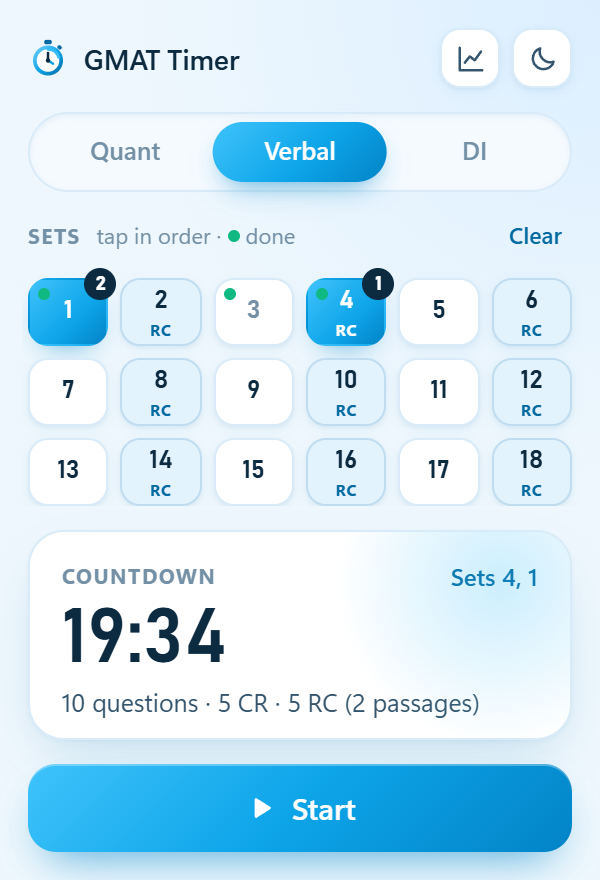
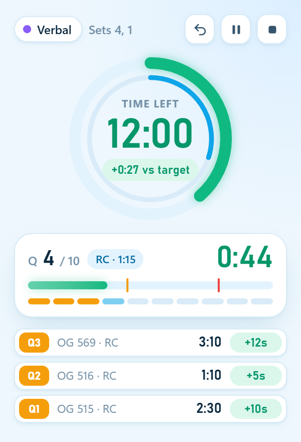
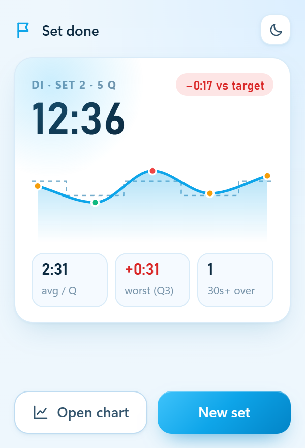
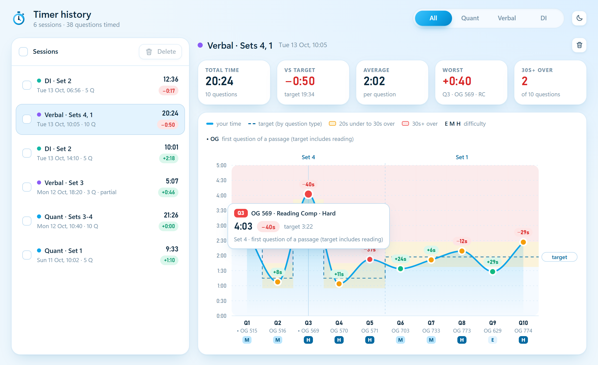
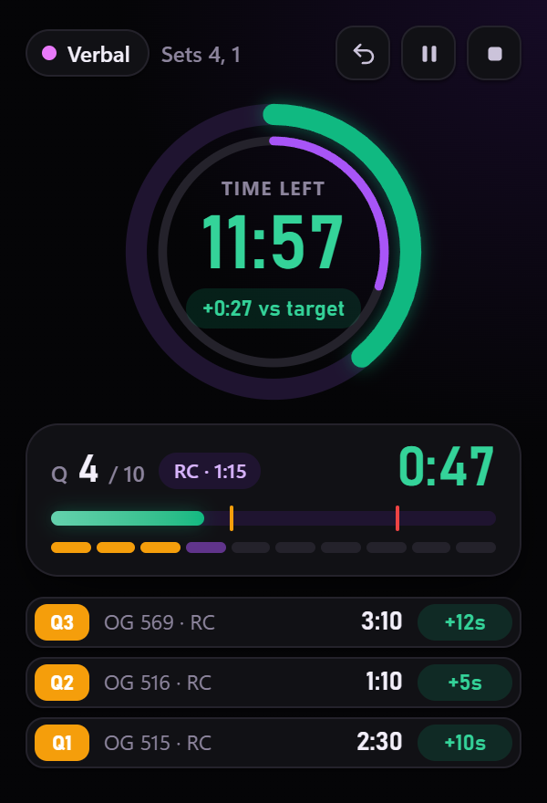
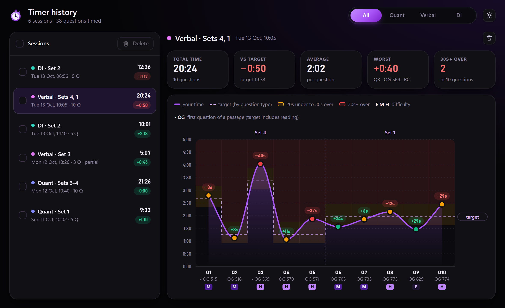

# GMAT Timer

A floating, always-on-top timer for timed GMAT practice sets. Pick the sets you are about to do, press **Q** after each question, and it times every question against a target for its type. Every session is saved, and the History window charts it question by question.

| Pick sets | Running | Set done |
|---|---|---|
|  |  |  |



Dark mode is black with purple highlights:

| Running (dark) | History (dark) |
|---|---|
|  |  |

## Features

- **Pick any sets, in any order.** The setup screen shows every set in the booklet as a grid.
  - Tap sets in the order you will do them. Numbered badges show the order, and **Clear** resets it.
  - RC sets are tinted and tagged; bonus sets show as B1, B2 and so on.
  - A green dot marks sets you have already timed.
  - The countdown card shows the total time and a breakdown, for example "15 questions · 10 CR · 5 RC (2 passages)".
- **Targets by question type.** The countdown is the sum of one target per question, and each section keeps its real exam budget. See [How timing works](#how-timing-works).
- **Two rings.**
  - The outer ring is time used. It turns green, yellow or red by your gap to target.
  - The inner ring is questions done. If the inner ring is ahead of the outer one, you are ahead.
- **Per-question timer.** It goes green, then yellow, then red against that question's own target. A chip shows the question's type and target, such as `DS · 2:02` or `RC + read · 3:50`.
- **F1-style splits.** A row of mini sectors (one per question) is coloured by that question's time. The last three splits show time and `+12s` or `−18s` against target.
- **Global Q hotkey.** Q works even while another app has focus, for example Edge with a PDF you are writing on. It is active only while a set runs and is not paused.
- **Pause, Undo Q and End.** Pause blurs the widget behind a Resume card. Undo puts the last split back on the clock. End needs two clicks within 3 seconds.
- **Set done card.** It shows the total, the gap to target, a sparkline, the average per question, the worst question and the count of 30s+ overruns.
- **History window.** It opens by itself when a set finishes.
  - Filter by section, and see tiles for total, vs target, average, worst and 30s+ over.
  - A smooth line chart has a zone for each question (yellow near target, red 30s+ over), a dashed step line of the targets, and `+Ns` / `−Ns` labels.
  - The OG number and difficulty (E, M, H) sit under each point. Hover any point for details.
  - Delete sessions with checkboxes, the trash button or the Delete key, with a confirm dialog. Arrow keys move through sessions.
- **Light and dark themes.** Light is sky blue; dark is black with purple. The sun/moon button switches both windows at once.
- **Resizable.** Drag the widget's edge and everything scales. Its position and size are remembered.

## Requirements

- Windows 10 or 11
- Python 3.10 or newer (standard library only, nothing to install)
- Microsoft Edge (installed with Windows)
- The practice booklet files `Q.html`, `DI.html` and `V.html` in one folder

The booklets are HTML practice booklets made from a personal copy of the GMAT Official Guide. They are not part of this repository. The timer reads two things from each file:

- **Set tracker rows** with the set name, its type and the OG question numbers:
  ```html
  <tr><td>Set 1</td><td>mixed</td><td>221, 91, 124, 109, 190</td>
  <tr><td>Set 2</td><td>RC</td><td>505-508, 509-514</td>
  ```
  In an RC set, each range is one passage.
- **Answer table rows** with each question's difficulty:
  ```html
  <tr><td><b>221</b></td><td class="a">E</td><td><span class="lv Hard">Hard</span></td>
  ```

## Run

```bat
pythonw gmat_timer.pyw --data "D:\GMAT\timer data"
```

| Option | What it is | Default |
|---|---|---|
| `--data DIR` | Where `timer_history.json` and `Timer History.csv` are kept | the script's folder |
| `--booklets DIR` | Where `Q.html`, `DI.html` and `V.html` are | `DATA\og_booklets` |

A desktop shortcut works well. Set the target to the command above and the icon to `timer_ui\icon.ico`. Double-clicking the shortcut again while the timer is open brings the widget to the front; it does not open a second timer.

## How timing works

Each question gets a target from its type. The targets keep each section's real exam budget (45 minutes for 21 Quant, 23 Verbal and 20 Data Insights questions).

| Section | Question type (by OG number) | Target |
|---|---|---|
| Quant | Problem Solving (1-272) | 2:09 |
| Verbal | Critical Reasoning (613-802) | 1:57 |
| Verbal | Reading Comprehension (467-612) | 1:57 on average per question |
| Data Insights | Data Sufficiency (273-409) | 2:02 |
| Data Insights | Two-Part Analysis (410-466) | 2:45 |

- **Reading Comprehension.** Up to 2:30 of reading moves onto the first question of each passage, and the passage total stays at 1:57 per question. Every other question in the passage keeps at least 1:15. For example:
  - a 4-question passage: 3:50, then 1:20 for each of the other three;
  - a 2-question passage: 2:40, then 1:15.
- **Data Insights.** DS 2:02 and Two-Part 2:45 average out to the real 2:15 for the booklet's mix of 137 DS and 57 Two-Part questions. A set with more Two-Part questions gets more time.
- **Colours per question.**
  - Green until 20 seconds before the target.
  - Yellow from target − 20s.
  - Red from target + 30s.

  For Quant that is yellow at 1:49 and red at 2:39.
- **Gap to target** (the big ring and the pill under the countdown) is the targets of the finished questions minus the time used, minus any overrun on the current question.
  - Green: on or ahead of target.
  - Yellow: up to 30 seconds behind.
  - Red: further behind, or past zero.
- **Splits** show `target − time`. A `+` means time gained.

## Data files

Both files live in the `--data` folder.

**`timer_history.json`** is the record: a list of sessions. A session looks like this:

```json
{
  "id": "s1791885921958",
  "date": "2026-10-13 10:05",
  "section": "V",
  "sets": ["Set 4", "Set 1"],
  "pace": 117.4,
  "complete": true,
  "questions": [
    {"og": 515, "set": "Set 4", "level": "Medium", "read": true, "type": "RC", "target": 160.0, "sec": 168.2}
  ]
}
```

- `sets` is in the order you did them.
- `read` marks the first question of an RC passage.
- `complete` is false when a set was ended early, or when the window was closed mid-set.
- Sessions saved before type targets existed have no `type` or `target`. They are charted against `pace`.

**`Timer History.csv`** has one row per question, for spreadsheets. It is rebuilt from the JSON on every save, so deleting a session removes it from both. The columns are:

`date, section, set, q in session, OG #, type, level, seconds, target, vs target (+ = gained)`

## Customize

| What | Where |
|---|---|
| Targets, colour offsets, gap threshold, Q debounce | top of `gmat_timer.pyw` (`TARGET`, `RC_PACE`, `READ`, `RC_MIN`, `YELLOW_OFF`, `RED_OFF`, `GAP_RED`, `DEBOUNCE`) |
| Port | `PORT` in `gmat_timer.pyw` (default 47521) |
| Colours, both themes | the tokens at the top of `timer_ui/ui.css` |
| Widget design size | `BASE_W` / `BASE_H` in both `gmat_timer.pyw` and `timer_ui/widget.js` |

## Troubleshooting

- **I can't type "q" anywhere.** A set is running, and the Q hotkey takes every Q press. Pause or end the set and Q types normally again.
- **"Q hotkey is busy".** Another program owns Q as a hotkey. Click the widget, then press Q; the widget catches Q while it has focus.
- **The window does not open.** The log is at `%LOCALAPPDATA%\GMATTimer\log.txt`. Edge must be at its usual install path.
- **"Booklet not found".** The widget shows the path it looked at. Point `--booklets` (or `--data`) at the right folder.
- **The widget opens somewhere odd.** Delete `%LOCALAPPDATA%\GMATTimer\settings.json` and it goes back to the right edge of the screen.

## Project layout

```
gmat_timer.pyw        server, clock, global hotkey, history, Edge window management
timer_ui/
  widget.html/.js     the floating timer
  results.html/.js    the History window
  common.js           API calls, formats, icons, theme, charts
  ui.css              styles and theme tokens
  icon.svg, icon-dark.svg, icon.ico
docs/screenshots/     README images (made from sample data)
ARCHITECTURE.md       how it works inside
CHANGELOG.md          version history
```

## License

MIT. See [LICENSE](LICENSE).
